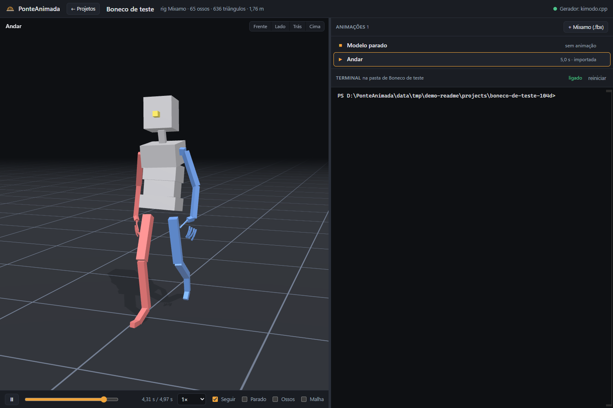
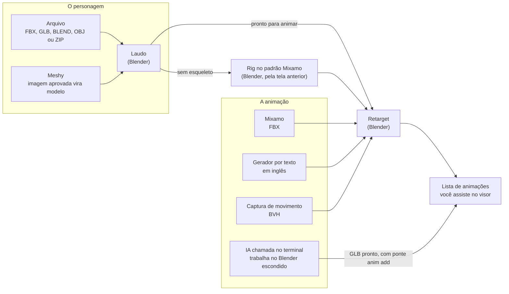
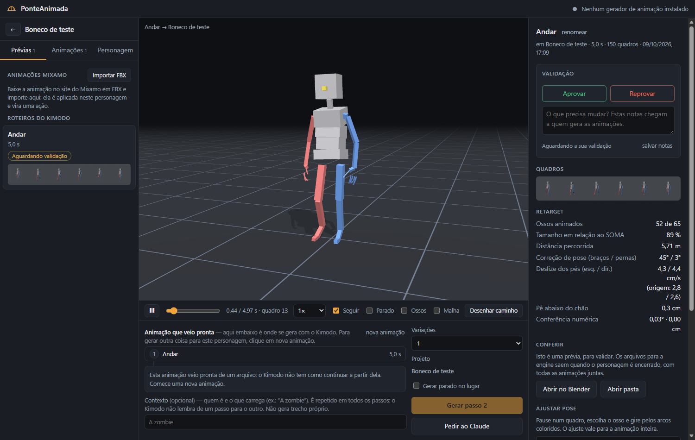

<p align="center">
  
</p>

# PonteAnimada

Ferramenta local, para Windows, para cuidar do que entra num jogo: os personagens 3D, com as
animações de cada um, e os assets (modelos, texturas e sons). Cada projeto é um **jogo**, e a
tela dele é dividida em **abas**: duas vêm com o jogo e as outras você cria. Nelas ficam:

- os **Characters**: cada personagem abre num **visor 3D**, texturizado, parado ou animado, com
  a **lista de animações** dele ao lado;
- os **Assets**: o que não é personagem, cada um aberto no mesmo lugar (o modelo no visor, a
  textura como imagem, o som num tocador);
- a **gestão** do jogo, numa aba que você cria: um **quadro de tarefas** (a fazer, fazendo,
  feito) e os **documentos** do jogo (ideias, regras, roteiro);
- um **terminal** sempre à direita, aberto na pasta de onde você está (o jogo, o personagem ou
  o asset), onde você chama a IA que quiser (o Claude Code ou outra) e pede a animação, o asset
  ou a jogabilidade em português. Ela já entra sabendo no que vai mexer.

A IA trabalha no **Blender**, que roda escondido, e põe o resultado na tela. Você assiste ao
lado e diz o que achou. É essa a **ponte**: entre você, a IA e o Blender.

As animações também vêm prontas do Mixamo (por um botão), de um gerador por texto (o
[Kimodo](https://github.com/nv-tlabs/kimodo), da NVIDIA) ou de captura de movimento. O Blender
as aplica no personagem, seja qual for o esqueleto dele.

> *In English:* a local Windows tool (interface in Portuguese) to manage what goes into a game:
> 3D characters with their animations, and assets (models, textures, sounds). Each project is a
> game, with its characters and its assets; the game, each character and each asset has its own
> terminal, opened in its own folder, where you call the AI assistant of your choice (Claude Code or another) to build animations in a headless
> Blender and review every clip in a 3D viewport. Motion can also come from Mixamo FBX,
> text-to-motion (Kimodo) or BVH mocap; Blender inspects, rigs and retargets.



*A tela de um personagem: a caminhada de exemplo no boneco de teste, a lista de animações e o
terminal. (A imagem é de antes dos jogos: hoje a barra de cima volta para o jogo.)*

## O que ele faz

- **Mostra o personagem e as animações.** Visor 3D no navegador, com a textura: vistas de
  frente, lado, trás e cima, tocar e pausar, barra de tempo, velocidade, esqueleto à mostra.
- **Junta tudo por jogo.** Cada jogo tem os personagens dele (*Characters*) e os *Assets*:
  modelos 3D que não são personagem (arma, objeto, cenário), texturas e sons.
- **Deixa você organizar o jogo em abas.** Além das duas que vêm com ele, você cria as suas, de
  personagens, de assets ou de gestão. Numa aba de gestão ficam um quadro de tarefas e os
  documentos do jogo, que a IA do terminal também lê e escreve.
- **Abre um terminal na pasta de cada espaço**: o jogo, cada personagem e cada asset têm o
  deles. É um PowerShell de verdade, dentro da tela, e vem parado: você chama ali a IA que
  preferir. A pasta tem um guia (`CLAUDE.md` e `AGENTS.md`) que diz a ela onde está e no que vai
  mexer (o jogo, aquele personagem ou aquele asset), onde está o código do jogo, como rodar o
  Blender escondido e como pôr o trabalho na tela.
- **Recebe animação feita no Blender.** Um GLB com o personagem já animado entra na lista com
  um comando (`ponte anim add`), e a tela o mostra em seguida.
- **Simula o jogo.** Você anda com o personagem pelo teclado ou clicando no chão, e as
  animações trocam sozinhas entre parado, andando e correndo. Mostra o que uma animação
  sozinha não mostra: a troca de uma para a outra e o pé deslizando.
- **Aproveita animação pronta**: FBX do Mixamo, por um botão, e captura de movimento em BVH.
- **Aplica a animação no personagem** (retarget), seja qual for o esqueleto dele. Reconhece os
  nomes de osso mais comuns: Mixamo, Unreal, Unity, Blender, VRM e Biped.
- **Examina o personagem.** Aceita FBX, GLB, BLEND, OBJ ou um ZIP com o modelo e as texturas.
  O Blender faz um laudo: tipo de esqueleto, ossos reconhecidos, pose de descanso, escala,
  pesos e texturas.
- **Gera animação a partir de texto**, com um gerador instalado: um roteiro em inglês, um
  passo de cada vez, com transição entre os passos.
- **Pede o personagem ao Meshy**: primeiro a imagem, que você aprova, e só então o modelo 3D.
- **Na tela anterior**, que continua disponível: rigar quem chega sem esqueleto, aprovar e
  reprovar com notas, ajustar a pose, prender arma e acessórios, e encerrar o personagem num
  arquivo só (GLB, FBX e BLEND, com um FBX para a Unreal 5 como opção).

A ponte roda inteira na sua máquina. Para a internet só vai o que você chamar: a IA do terminal
e, se quiser, o Meshy, que é um serviço pago. Não há conta nem banco de dados: o que a ponte
sabe está em arquivos, na pasta `data/`. O servidor só atende ao próprio computador
(`127.0.0.1`).

## Como funciona



O que você acha de cada animação é dito à IA, no terminal, e ela refaz. Uma animação de cada
vez funciona melhor do que um pacote inteiro de uma vez.

## Estado do projeto

Projeto pessoal, em uso, feito para levar personagens animados a um jogo na Godot. Vale saber
antes de instalar:

- **A tela é nova.** Foi refeita em 11/10/2026 para ficar só com o visor, as animações e o
  terminal, e em 13/10/2026 ganhou os jogos: cada projeto passou a ser um jogo, com os
  personagens e os assets dentro. É a primeira versão das duas coisas. A tela anterior, mais
  completa (laudo, rig, roteiro, revisão, ajuste de pose, acessórios, encerrar), continua
  inteira em `/antiga/`, sem saber de jogos: veja [A tela anterior](#a-tela-anterior).
- **Windows.** Feito e usado no Windows 11. O terminal da tela, os atalhos, os scripts de abrir
  e parar e a ligação com o Kimodo (que roda no WSL) dependem dele. Em outro sistema não foi
  testado.
- **A IA e o gerador de animação não vêm juntos.** A IA do terminal é a que você tiver
  instalada. O gerador por texto é instalado à parte e pede uma máquina forte (veja
  [Requisitos](#requisitos)). Sem os dois a ponte serve para o resto: receber personagem,
  importar animação do Mixamo e captura, e ver tudo no visor.
- **Em português**: a interface, a linha de comando e as mensagens.
- O que já foi conferido e o que ainda não foi está, sem enfeite, em
  [Limites conhecidos](#limites-conhecidos).

## Requisitos

| Para | Precisa de |
|---|---|
| Rodar a ponte | Windows, [uv](https://docs.astral.sh/uv/) (ele baixa o Python sozinho), [Blender](https://www.blender.org/) 5.2 e [Node.js](https://nodejs.org/) (só para baixar o three.js e o xterm.js) |
| Abrir em janela própria | Microsoft Edge. Sem ele, a interface abre no navegador padrão |
| Pedir animação a uma IA | uma IA de linha de comando instalada, como o [Claude Code](https://claude.com/claude-code). Sem ela, o terminal da tela é só um PowerShell na pasta do projeto |
| Gerar com o Kimodo original | Docker Desktop, WSL 2 com Ubuntu e placa NVIDIA. O text encoder ocupa uns 17 GB de RAM; no disco, 35 GB da imagem do Docker e 17 GB de modelos |
| Gerar com o kimodo.cpp | Visual Studio 2022 com CMake, para compilar, e uns 9 GB de pesos |
| Gerar com o ARDY | WSL 2 com Ubuntu e placa NVIDIA. O codificador de texto ocupa uns 16 GB de RAM, só enquanto codifica um texto novo; no disco, 17 GB de modelos |
| Arquivo para a Unreal 5 | só o Blender. A Unreal entra apenas se você quiser rodar o teste que importa nela |

Os números do Kimodo foram medidos numa máquina com 32 GB de RAM e uma RTX 3060 de 12 GB.

## Instalação

```powershell
git clone https://github.com/dap4ever/ponte-animada.git
cd ponte-animada
uv sync                     # o backend (cria o .venv)
npm install --prefix web    # o three.js e o xterm.js, servidos direto de web/node_modules
```

Depois:

1. Abra o `ponte.toml`, que no repositório é o da máquina do autor. Ponha em `[blender] exe` o
   caminho do `blender.exe` da sua máquina e, em `[kimodo_cpp]`, deixe `repo = ""` (ou aponte
   para onde você compilou o kimodo.cpp).
2. Rode `uv run ponte serve` e abra <http://127.0.0.1:8765>.
3. Se quiser um atalho na Área de Trabalho, rode uma vez
   `powershell -ExecutionPolicy Bypass -File scripts\criar-atalho.ps1`.

Para ligar um gerador por texto, veja [Geradores de animação](#geradores-de-animação).

### Ver funcionando sem gerador

O repositório traz um boneco de teste e uma caminhada de exemplo. Com eles dá para ver uma
animação na tela sem instalar gerador nem IA (é a imagem do alto desta página):

```powershell
uv run ponte fixture        # cria o projeto "Boneco de teste" e mostra o id dele
uv run ponte motion import <projeto> tests\fixtures\kimodo_walk_forward.bvh --label "Andar"
uv run ponte retarget <projeto> <animacao>      # o id da animação sai no comando anterior
uv run ponte game new "Meu jogo"                # cria um jogo e mostra o id dele
uv run ponte game add <jogo> <projeto>          # põe o boneco no jogo
uv run ponte serve
```

## Abrir

Dê dois cliques no atalho **PonteAnimada** da Área de Trabalho (ou em `Abrir-PonteAnimada.cmd`).
Ele sobe o servidor local e abre a interface numa janela própria. Para encerrar o servidor,
use `Parar-PonteAnimada.cmd` (ele se recusa a parar enquanto houver animação sendo gerada
ou aplicada). Se mover a pasta do projeto, rode `scripts\criar-atalho.ps1` para refazer o atalho.

## Neste documento

**Usar**

- [A tela](#a-tela)
- [O terminal e a IA](#o-terminal-e-a-ia)
- [Animação feita no Blender](#animação-feita-no-blender)
- [O simulador](#o-simulador)
- [Animações do Mixamo](#animações-do-mixamo)
- [Personagem pelo Meshy](#personagem-pelo-meshy)
- [Capturas de movimento (BVH)](#capturas-de-movimento-bvh)
- [Texturas](#texturas)
- [Linha de comando](#linha-de-comando)

**A tela anterior**

- [A tela anterior](#a-tela-anterior)
- [Fluxo na tela anterior](#fluxo-na-tela-anterior)
- [Projetos, prévias e resultado](#projetos-prévias-e-resultado)
- [Rigar aqui (padrão Mixamo)](#rigar-aqui-padrão-mixamo)
- [Roteiro: uma animação com começo, meio e transições](#roteiro-uma-animação-com-começo-meio-e-transições)
- [Ajustar a pose](#ajustar-a-pose)
- [Arma e acessórios](#arma-e-acessórios)
- [Unreal 5](#unreal-5)

**Entender e mexer**

- [Geradores de animação](#geradores-de-animação)
- [Como é por dentro](#como-é-por-dentro)
- [Testes](#testes)
- [Limites conhecidos](#limites-conhecidos)
- [Pastas](#pastas)

## A tela

A tela foi refeita em 11/10/2026 para ficar só com o que é usado, e em 13/10/2026 ganhou os
jogos. É a primeira versão. O caminho é **Projetos > o jogo > um personagem ou um asset**, com o
terminal sempre à direita.

**Entrada (Projetos).** Um cartão por jogo e o cartão *Novo jogo*. O **×** no canto do cartão
exclui o jogo, com confirmação: as texturas e os sons dele saem do disco (e as tarefas e os
documentos da gestão), mas os personagens e os modelos 3D não, ficam **sem jogo**. É nessa lista, logo abaixo, que aparece todo projeto que
ainda não está em nenhum jogo (o que o Meshy acabou de criar, o que veio de antes dos jogos),
com a escolha do jogo embaixo do cartão. Ali ficam também os pedidos ao Meshy e o que estiver
rodando. À direita, um **terminal na pasta da ponte**: é onde se chama a IA para o que não é de
um jogo só.

**Jogo.** Uma barra de abas, o que há na aba escolhida e o terminal do jogo. Duas abas vêm com
o jogo:

- **Characters**: um cartão por personagem, com quantas animações ele tem, e *Novo personagem*
  (FBX, GLB, BLEND, OBJ ou um ZIP com as texturas).
- **Assets**: os modelos 3D que não são personagem, as texturas (PNG, JPG, WEBP, BMP, GIF, TGA,
  TIFF, EXR, HDR, DDS, PSD) e os sons (WAV, OGG, MP3, FLAC), e *Novo asset*.

**+ Nova aba** cria as outras: você dá o nome e escolhe o tipo, **personagens**, **assets** ou
**gestão** (o tipo não muda depois). Serve para separar o jogo do seu jeito: uma aba só de
zumbis, outra do cenário, outra de planejamento. Dois cliques no nome de uma aba (ou *mudar o
nome*, logo abaixo) mudam o nome; *apagar a aba* só existe nas que você criou. Apagar uma aba de
personagens ou de assets não apaga o que está nela: volta para a aba que vem com o jogo. Apagar
uma de gestão leva as tarefas e os documentos dela.

No cartão, o **×** apaga e o **⇄** passa o personagem ou o asset para outra aba (o arquivo e as
animações ficam como estão). A aba de destino diz o que ele é: numa de personagens, personagem;
numa de assets, modelo. Com mais de um destino, o **⇄** abre a lista das abas. Arrastando
arquivos para a janela, ela se divide em dois lados, *personagem* e *asset*: o lado em que você
solta diz o que o arquivo é, e ele entra na aba aberta, se for desse tipo. Uma imagem solta
junto com um modelo é textura dele; sozinha, é um asset. Na barra de cima, um clique no nome do
jogo muda o nome, e ao lado fica a **pasta do código do jogo** (o projeto na Godot, por
exemplo): é opcional, e serve para a IA do terminal saber onde fazer a jogabilidade.

**Aba de gestão.** Duas partes:

- **Tarefas**: um quadro com três colunas, *A fazer*, *Fazendo* e *Feito*. Escreva no campo do
  alto e aperte Enter para criar. O cartão muda de coluna pelas setas dele ou arrastado; um
  clique abre a tarefa, para mudar o título, o detalhe e a coluna, ou apagar. O número ao lado
  do nome da aba é o que ainda não está feito.
- **Documentos**: textos do jogo (ideias, regras, roteiro de missão), um arquivo Markdown cada.
  *Novo documento* cria um em branco; um `.md` ou `.txt` arrastado para a janela também entra.
  Aberto, o documento aparece formatado, com o terminal dele ao lado; **Editar** troca a página
  pelo texto, para você escrever (Ctrl+S salva), e uma caixa de marcar (`- [ ]`) se marca com
  um clique.

A IA chamada no terminal lê e atualiza os dois: as tarefas pela linha de comando
(`ponte game task ...`) e os documentos gravando o arquivo. O que ela muda aparece na tela em 2
segundos, sem recarregar.

**Asset aberto.** O modelo vai para o visor; a textura aparece como imagem, sobre um xadrez que
mostra onde ela é transparente (as que o navegador não mostra, como TGA e EXR, ficam guardadas
e têm o link para baixar); o som, num tocador. À direita, o que ele é: arquivo, tamanho, e as
dimensões ou a duração.

**Personagem.** Três partes:

- **Visor 3D**, à esquerda: o personagem com a textura, parado ou tocando a animação escolhida.
  Botões de vista (*Frente*, *Lado*, *Trás*, *Cima*), tocar e pausar (ou Espaço), barra de
  tempo, velocidade, e as opções *Seguir* (a câmera acompanha o personagem), *Parado* (tira o
  deslocamento, só para ver), *Ossos* e *Malha*. O mouse gira, aproxima e arrasta a vista.
  Trocar de animação não mexe na câmera, para comparar do mesmo ângulo.
- **Animações**, à direita: *Modelo parado* e uma linha por animação, em ordem pelo nome, com a
  duração e de onde veio (Mixamo, Blender, captura, importada ou gerada). Clique para ver; dois
  cliques mudam o nome; o **×** apaga. O **✓** aprova a animação e a põe numa pasta, com o nome
  que você der (o modo do jogo, por exemplo): a pasta abre e fecha num clique, dois cliques mudam
  o nome dela e o **↩** tira a animação de lá. O que não foi aprovado fica fora das pastas.
  Animação que chega com a tela aberta abre sozinha no visor. O botão **+ Mixamo (.fbx)** importa
  as baixadas do Mixamo ([Animações do Mixamo](#animações-do-mixamo)), e **Simular** abre o
  [simulador](#o-simulador).
- **Terminal**, embaixo da lista: o do personagem, aberto na pasta dele. O do jogo fica na tela
  do jogo, esperando a volta. Num asset aberto é igual: o terminal é o daquele asset.

A divisória entre as duas metades arrasta. O endereço guarda onde se está (`#g/<jogo>/<aba>`,
`#p/<projeto>/<animação>`, `#i/<textura, som ou documento>`): recarregar a página volta ao mesmo
lugar.

### O terminal e a IA

O terminal **vem parado**: ele não chama nada sozinho. Você digita o comando da IA que quiser
usar (`claude`, por exemplo) e conversa com ela ali, olhando o visor.

- **Um terminal por espaço.** O painel é um só e mostra o de onde você está; o cabeçalho diz
  qual. Na tela do jogo é o do jogo, aberto na pasta dele dentro da ponte (`data/games/<jogo>/`,
  e não na pasta do código). Dentro de um personagem ou de um modelo 3D é o dele
  (`data/projects/<id>/`); dentro de uma textura, de um som ou de um documento, o dele
  (`data/games/<jogo>/assets/<id>/`). São terminais separados, cada um com a conversa dele: a IA
  chamada num asset trabalha naquele asset; a do jogo, no jogo inteiro e na jogabilidade. Trocar
  de aba na tela do jogo não troca de terminal: em todas é o do jogo, e é ele que cuida do
  quadro de tarefas.
- **O guia da pasta.** Ao abrir o terminal, a ponte grava na pasta um guia com dois nomes,
  `CLAUDE.md` (o que o Claude Code lê) e `AGENTS.md` (o que o Codex, o opencode e outras leem),
  com o mesmo texto. O do jogo diz quem está escrevendo, que jogo é, onde está o código dele, os
  personagens e os modelos com a pasta de cada um, como rodar o Blender sem janela e como pôr o
  trabalho na tela. O de um personagem ou de um asset diz que é nele que a IA vai mexer, de que
  jogo é e como mostrar o resultado (a animação, o modelo mudado, o arquivo novo). Cada um é
  regravado a cada vez que a tela se liga ao terminal, enquanto começar pela linha de marca:
  apague essa linha e a ponte não toca mais naquele arquivo. O que for só de um personagem vai
  num `NOTAS.md` escrito à mão na pasta dele (`data/projects/<id>/`). A ponte nunca o grava, e o
  guia aponta para ele.
- **O Blender roda escondido**, comandado pela IA. Você não abre o Blender: o que você vê é o
  visor.
- **O terminal não fica para trás à toa.** Se ninguém escreveu nele, fecha sozinho 20 segundos
  depois de você sair dali. Com algo escrito, ele espera a sua volta: ir para outra tela,
  recarregar ou fechar a janela só solta a tela, e ao voltar o que estava escrito reaparece.
  Ele só fecha depois de 3 horas calado sem ninguém olhando, quando você clica em *reiniciar*
  ou quando o servidor para.
- **Parar o servidor fecha os terminais**, com a conversa que estiver rodando neles. No Claude
  Code, `claude --continue` num terminal novo retoma a anterior.
- **Um terminal na página é um shell na sua máquina.** Ele só atende à própria página da ponte:
  o pedido tem de vir de `127.0.0.1` ou `localhost`, na mesma porta, e trazer uma senha
  sorteada a cada vez que o servidor sobe. Não ponha o servidor para escutar fora do
  `127.0.0.1`.

### Animação feita no Blender

Uma animação pronta entra na lista sem passar pelo retarget. É o caminho da IA do terminal, e
serve também para o que você mesmo fizer no Blender:

1. Exporte um **GLB** com o personagem (e os acessórios) já animado, uma ação por arquivo,
   começando no tempo 0. No exportador de glTF do Blender é a opção
   `export_anim_slide_to_zero`: sem ela o laço ganha um quadro parado.
2. Rode `uv run ponte anim add <projeto> <arquivo.glb> --name "<nome>"`.

Ela entra na lista em até 2 segundos, e abre sozinha se o projeto estiver na tela. `--replace`
troca a de mesmo nome; `--blend <arquivo>` guarda junto o arquivo do Blender de onde ela saiu.
O GLB é mostrado como veio: nada nele é conferido nem corrigido.

### O simulador

O botão **Simular**, no alto da lista de animações, abre o personagem num chão quadriculado
para testar as animações **como num jogo**: você anda com ele e elas trocam sozinhas.

- **Comandos**: `W` `A` `S` `D` ou as setas andam, `Shift` corre, um clique no chão manda o
  personagem até o ponto (como num jogo de estratégia), arrastar o mouse gira a câmera, a
  rodinha aproxima, `C` troca entre a câmera de perto e a de cima, `R` volta ao centro.
- **Qual animação toca em cada momento**: parado, andando e correndo, e também começar e parar
  de andar, virar para um lado e dar meia-volta (andando, parado ou correndo). O simulador
  escolhe pelo nome: `idle` ou parado, `walk` ou andar, `run` ou correr, e para os outros
  momentos os nomes de jogo (`idle_to_walk`, `walk_to_idle`, `turn_left`, `turn_right`,
  `turn_around`, `turn_left_idle`, `run_turn_left`...). O nome exato ganha de um parecido, e
  nomes com espaço, como os do Mixamo (`walk forward`), valem como se fossem com sublinhado. Você
  troca em cada lista. Sem animação de virar, ele vira de uma vez e anda para onde aponta. As
  outras animações do projeto ficam em **Tocar uma vez**, nas teclas de número.
- **Dois conjuntos**: *patrulha* usa os nomes do jogo e *alerta*, os mesmos nomes terminados em
  `_aiming` (a arma no ombro). O seletor **Conjunto** troca, e a tecla `Q` alterna no meio do
  jogo.
- **O passo da animação**: ele mede a que velocidade cada animação anda, pelo deslocamento
  dela ou, se foi feita parada no lugar, pelo que a ponta do pé faz enquanto está no chão. O
  personagem começa andando nessa velocidade, que é a que não deixa o pé deslizar.
- **Pé deslizando**: mude a velocidade (para a do seu jogo, por exemplo) e o quadro do canto
  diz quanto o pé desliza, em centímetros por segundo. Com *Acelerar ou frear a animação*
  ligado, a animação toca mais rápida ou mais lenta para o passo acompanhar, como muitos jogos
  fazem, e o quadro mostra em quanto.
- **A troca**: o tempo de passar de uma animação para a outra e a rapidez com que o personagem
  vira também se ajustam ali.

O simulador não muda nada no projeto: os ajustes ficam guardados no navegador, por
personagem. As velocidades valem para o tamanho que o personagem tem no arquivo. Uma animação
com deslocamento toca parada no lugar (sai o deslocamento em linha reta), porque quem leva o
personagem é o simulador, como o código de um jogo faria.

## Animações do Mixamo

Para as ações que o Mixamo já tem prontas (parado, andar, ataque…), não é preciso gerar: baixe
a animação de lá em FBX e, no projeto do personagem, clique **+ Mixamo (.fbx)**, no alto da
lista de animações (dá para escolher vários de uma vez). O Blender aplica cada arquivo no
personagem do projeto, por trás, e ele vira uma animação com o nome do arquivo: entra na lista
quando o Blender termina (8 segundos num personagem leve, mais com texturas grandes) e abre
sozinha no visor.

A animação passa pelo mesmo retarget das do Kimodo, então serve em qualquer personagem, tenha
ele ou não o esqueleto do arquivo, e tanto faz baixar com ou sem a malha (*With Skin* /
*Without Skin*). Tudo é amostrado a 30 quadros por segundo. Soltar um FBX na janela com um
projeto aberto pergunta se ele é uma animação do Mixamo ou um personagem novo.

Pela linha de comando: `uv run ponte motion import-fbx <projeto> "Zombie Idle.fbx"`. Na tela
anterior, é o botão **Importar FBX**, em **Animações Mixamo**, na aba *Prévias*.

## Personagem pelo Meshy

O [Meshy](https://www.meshy.ai) gera o modelo 3D do personagem a partir de uma imagem. Na ponte
isso acontece em **duas etapas, com a sua aprovação no meio**, para não gastar créditos num
modelo que você não quer:

1. **A imagem.** Quem faz o pedido (a IA do terminal, pela linha de comando, ou a API) descreve
   o personagem em inglês e o Meshy devolve uma imagem dele, em pose A ou T. Custa 3 créditos.
   Ela aparece em **Pedidos ao Meshy**, na tela de entrada.
2. **O modelo 3D.** Você olha a imagem (clicar nela abre inteira) e escolhe **Aprovar e gerar o
   3D** ou **Reprovar**, com uma nota dizendo o que mudar. Só a aprovada vira modelo: leva
   alguns minutos, custa dezenas de créditos e chega como **projeto novo**, já com o laudo.
   O modelo vem sem esqueleto: é só rigar, pela tela anterior
   ([Rigar aqui](#rigar-aqui-padrão-mixamo)).

```powershell
uv run ponte meshy key msy_...                       # guarda a chave (uma vez); mostra os créditos
uv run ponte meshy image "A zombie woman, full body, torn clothes, game character" --name "Zumbi"
uv run ponte meshy status                            # os pedidos; a nota de um reprovado diz o que mudar
uv run ponte meshy image "..." --name "Zumbi" --replace <pedido>   # refaz um reprovado
uv run ponte meshy approve <pedido>                  # o mesmo que o botão da tela
uv run ponte meshy reject <pedido> --note "sem capuz"
```

- **A chave** é criada em <https://www.meshy.ai/developers/keys> (a API exige plano pago). Fica
  em `meshy.key`, na raiz do projeto, fora do git e fora do que a interface serve; a variável
  `MESHY_API_KEY` também vale.
- **A malha chega reduzida** a 50 mil triângulos (`--polycount`, em `approve`; 0 deixa como o
  Meshy gerar, que passa de 800 mil e deixa o Blender lento).
- **Se algo cai no meio**, nada é pago duas vezes: a imagem aprovada continua aprovável, e um
  modelo que o Meshy já estava gerando é retomado (**Retomar**, no cartão).
- **Pela API da ponte**: `POST /api/meshy/requests` (a imagem), `POST
  /api/meshy/requests/<id>/approve`, `.../reject` e `DELETE /api/meshy/requests/<id>`.
- **Pelo MCP oficial do Meshy**, para quem prefere que o assistente fale direto com ele, sem a
  ponte no meio: `npx add-mcp @meshy-ai/meshy-mcp-server --env MESHY_API_KEY=msy_...`. Aí o
  modelo baixado entra na ponte como qualquer arquivo (`uv run ponte asset add modelo.glb`).

## Capturas de movimento (BVH)

Captura de movimento pronta, em BVH de qualquer esqueleto humanoide (XSens, conjuntos abertos
como a [100STYLE](https://www.ianxmason.com/100style/)), entra pela linha de comando:

```powershell
uv run ponte motion import-capture <projeto> DragLeftLeg_FW.bvh --label "Andar arrastando a perna" `
    --start 7.15 --end 168.55 --loop --credit "The 100STYLE Dataset - Ian Mason (CC BY 4.0)"
```

- `--start` e `--end` recortam a tomada, em segundos do arquivo (quadro ÷ quadros por segundo).
- `--loop` fica só com o melhor laço do recorte e o fecha: procura o trecho em que o fim mais
  repete o começo (num andar, uma passada), tira aos poucos o giro que o ator fez nele e
  reparte pelo trecho a diferença que sobra. `--loop 2.4 3.4` pede outra duração, em segundos
  (padrão: de 0,6 a 4). Um laço que anda sai reto, na direção de `--direction` (padrão: a mais
  próxima entre frente, lados e trás).
- `--credit` guarda o crédito que a licença do arquivo pede; ele aparece na tela da animação.

A captura vira uma animação do personagem, como as do Mixamo, e aparece na lista do projeto
(na tela anterior, em **Capturas de movimento**, na aba *Prévias*). Na pasta da animação ficam
o arquivo como veio (`captura.bvh`) e o convertido (`motion.bvh`: nomes do SOMA 77,
centímetros, 30 quadros por segundo), que é o que o retarget e as medidas (`step_stats.py`)
leem. Ainda não há campo na interface para isto.

## Texturas

O personagem aparece texturizado no visor, nas animações e no resultado (GLB, FBX, BLEND).

- **Embutidas no arquivo** (GLB; FBX com mídia embutida; BLEND com recursos empacotados):
  não precisa fazer nada.
- **Em arquivos separados**: selecione o modelo **junto com as texturas**, ou arraste a
  **pasta inteira** para a janela — as subpastas são mantidas. Dá também para acrescentar
  depois, soltando as imagens na janela com o projeto aberto (na tela anterior há também o
  botão *Adicionar texturas*).
- **Modelo que não referencia as texturas**: elas são aplicadas pelo nome do arquivo, que
  precisa conter o nome do material e o papel — `Corpo_BaseColor.png`, `Corpo_Normal.png`,
  `Corpo_Roughness.png`, `Corpo_Metallic.png`. Se o modelo tem um material só, basta o papel.

O laudo diz o que foi encontrado, o que faltou e o que foi deduzido. Um ajuste é automático:
material marcado como transparente cuja textura tem o canal alfa todo opaco volta a ser opaco
(senão o personagem renderiza "falhado", com faces de trás aparecendo na frente).

Animações aplicadas antes de as texturas chegarem não mudam sozinhas: refaça com
`uv run ponte retarget <projeto> <animacao>` (ou *Refazer retarget*, na tela anterior).

## Linha de comando

É por onde a IA do terminal trabalha, e por onde você faz o mesmo à mão. Tudo que ela faz
aparece na interface, e ela funciona mesmo com o servidor fora do ar. Rigar, ajustar a pose e
posicionar acessórios são só pela tela anterior.

`<projeto>` é o id do projeto, que é o do personagem (aparece em `ponte status`); `<jogo>`, o
do jogo (`ponte game list`).

```powershell
uv run ponte serve                       # a interface, em http://127.0.0.1:8765 (rotas da API em /api/docs)
uv run ponte status                      # jogos, projetos, fila, o que foi aprovado/reprovado (com as notas) e o que já foi encerrado
uv run ponte game new "Meu jogo" [--path <pasta do código>]   # cria um jogo
uv run ponte game list                   # os jogos, e os projetos que não estão em nenhum
uv run ponte game show <jogo>            # o que há no jogo: personagens e assets, com a pasta de cada um
uv run ponte game add <jogo> <projeto> [--role modelo] [--tab <aba>]   # põe no jogo um projeto que já existe (com --role modelo, entre os assets; com --tab, numa aba)
uv run ponte game file <jogo> madeira.png passo.wav [--tab <aba>]   # textura ou som: entra nos assets do jogo; um .md ou .txt vira documento de uma aba de gestão
uv run ponte game path <jogo> <pasta>    # diz onde está o código do jogo
uv run ponte game tab list <jogo>        # as abas do jogo e o que há em cada uma
uv run ponte game tab new <jogo> "Zumbis" --kind personagens   # cria uma aba: personagens, assets ou gestao
uv run ponte game task list <jogo>       # o quadro de tarefas: a fazer, fazendo e feito, com o id de cada uma
uv run ponte game task add <jogo> "Fazer o portão" [--notes "..."] [--tab <aba>]   # cria uma tarefa
uv run ponte game task move <tarefa> a_fazer|fazendo|feito   # passa a tarefa para outra coluna
uv run ponte game task edit <tarefa> [--title "..."] [--notes "..."]   # corrige a tarefa (delete <tarefa> apaga)
uv run ponte game doc <jogo> "Regras do jogo" [--tab <aba>]   # cria um documento em branco e diz onde ficou o arquivo
uv run ponte asset add caixote.glb --game <jogo> --role modelo   # um modelo 3D que não é personagem
uv run ponte asset add personagem.fbx [--game <jogo>]   # cria o projeto e faz o laudo
uv run ponte asset add personagem.fbx --textures pasta_das_texturas
uv run ponte asset textures <projeto> cor.png normal.png   # acrescenta texturas e refaz o laudo
uv run ponte asset show <projeto>        # laudo e mapeamento de ossos
# Roteiro, um passo de cada vez: gere, confira a prévia e só então o próximo, com --continue.
uv run ponte gen "stands still, breathing." --premise "A zombie" --duration 6 --asset <projeto>
uv run ponte gen "walks forward slowly." --premise "A zombie" --duration 5 --continue <animacao> --asset <projeto>
# Refazer o último passo: parte da animação anterior e toma o lugar da que saiu errada.
uv run ponte gen "shuffles forward." --premise "A zombie" --duration 5 --continue <anterior> --replace <errada> --asset <projeto>
# Passo em laço (termina na pose em que começou); --text-weight para um gesto mais marcado.
uv run ponte gen "sways from side to side." --premise "A zombie" --duration 6 --loop --text-weight 4 --continue <animacao> --asset <projeto>
uv run ponte gen "..." --dry-run         # só confere que o roteiro monta; não gera nada
# Animação pronta: FBX do Mixamo, captura em BVH, ou um BVH do Kimodo que já existe.
uv run ponte motion import-fbx <projeto> "Zombie Idle.fbx"
uv run ponte motion import-capture <projeto> captura.bvh --loop
uv run ponte motion import <projeto> animacao.bvh
uv run ponte anim add <projeto> animado.glb --name "idle" [--replace]   # GLB com o personagem já animado (feito no Blender): entra na lista sem retarget
uv run ponte motion list                 # as animações, com o id de cada uma
uv run ponte motion label <animacao> --name "Reações" --steps "agitado" "vira"   # nome do roteiro e dos passos
uv run ponte retarget <projeto> <animacao> [--in-place]   # refaz a prévia
uv run ponte close <projeto>             # encerra o personagem: monta o resultado e cria o atalho
uv run ponte close <projeto> --unreal    # idem, e liga o arquivo para a Unreal 5 (--no-unreal desliga)
uv run ponte reopen <projeto>            # desfaz o encerramento
uv run ponte kimodo status|start|stop
uv run ponte engine [kimodo|cpp|ardy]    # mostra ou troca o gerador em uso
uv run ponte ardy status|start|stop      # o codificador de texto do ARDY (sobe sozinho para texto novo)
uv run ponte ardy sessions               # as sessões exportadas pelo demo ao vivo do ARDY
uv run ponte motion import-ardy <projeto> [sessão]   # traz uma sessão do demo (sem nome: a mais recente)
uv run ponte fixture                     # recria o boneco de teste
```

## A tela anterior

A tela de antes de 11/10/2026 continua inteira em <http://127.0.0.1:8765/antiga/>, sem link
na tela nova. É nela que ficam o laudo, o rig, o roteiro passo a passo, a revisão (aprovar e
reprovar), o ajuste de pose, os acessórios e o encerramento. As duas
telas leem o mesmo acervo. As seções seguintes, de
[Fluxo na tela anterior](#fluxo-na-tela-anterior) até [Unreal 5](#unreal-5), descrevem essa
tela.



*Uma prévia na tela anterior: a caminhada de exemplo aplicada no boneco de teste, com os botões
de validação e as medidas do retarget à direita.*

## Fluxo na tela anterior

1. **Novo projeto** — cada personagem enviado vira um projeto separado: FBX, GLB, BLEND, OBJ
   ou um ZIP com o modelo e as texturas (arraste para a janela). O Blender faz o laudo: tipo
   de rig, ossos reconhecidos, pose de descanso, escala, pesos, texturas. Só personagem com
   laudo *Pronto para animar* recebe animação. Se veio sem esqueleto, o laudo diz *Precisa de
   rig* e dá para rigar aqui (veja abaixo).
2. **Pedir animação** — monte o roteiro em inglês na barra de baixo. O Kimodo gera, o Blender
   aplica no personagem do projeto aberto e a **prévia** aparece na lista do projeto.
3. **Validar** — assista no visualizador (Espaço pausa, setas avançam quadro a quadro,
   *Ossos* mostra o esqueleto) e clique **Aprovar** ou **Reprovar**. As notas da reprovação
   são o que quem gera as animações lê para corrigir.
4. **Encerrar o personagem** — é só aqui que o **resultado** existe. Veja abaixo.

## Projetos, prévias e resultado

Cada upload de personagem cria um projeto, e tudo que nasce dele fica dentro dele: as
animações, as prévias, os acessórios. A interface abre na tela de **Projetos**; abrir um
projeto leva a uma tela só dele, com as abas *Prévias*, *Animações* e *Personagem* (o botão
**←** volta aos projetos). O **×** no canto do cartão exclui o projeto, com confirmação: vão
embora o personagem, as animações, as prévias e o resultado dele. Uma animação é sempre gerada
para o personagem do projeto aberto e não é usada em outro.

A **prévia** é a animação aplicada no personagem, para você validar. Ela não é a entrega.

O **resultado** só sai quando você **encerra o personagem** (botão *Encerrar personagem* na
aba Personagem, ou `uv run ponte close <projeto>`). Aí todas as prévias que você não reprovou
viram clipes de um arquivo só — `<nome>.glb`, `<nome>.fbx` e `<nome>.blend`, cada um com o
personagem, as texturas, os acessórios e todas as animações. O que sai é exatamente o que
foi validado: as animações vêm das prévias, sem recalcular. Reprovadas ficam de fora; as
que ainda não foram validadas entram, e o aviso de confirmação diz quantas são.

O resultado aparece **fora da pasta do projeto, como atalho**: na seção **Resultados** da
tela de projetos (e no alto da tela do projeto encerrado) e, no disco, em
`data\resultados\<Nome do personagem>.lnk`, que abre a pasta com os arquivos. O projeto não
fica travado: se mexer depois (animação nova, prévia reprovada, arma em outra posição), o
resultado aparece como *desatualizado* e basta encerrar de novo. *Desfazer o encerramento*
apaga o resultado e o atalho, e deixa o projeto como estava.

**Para a Unreal 5**: marque *Gerar também para a Unreal 5* antes de encerrar (ou
`uv run ponte close <projeto> --unreal`). O resultado ganha `unreal5\SK_<nome>.fbx`: o mesmo
personagem e as mesmas animações, no esqueleto do Mannequin (`root`, `pelvis`, `spine_01`...),
em centímetros. Arraste o arquivo para o Content Browser: entram a malha, o esqueleto e uma
animação por clipe, com o nome `SK_<nome>_<clipe>`. A opção fica guardada no personagem, e
ligá-la ou desligá-la deixa o resultado desatualizado. O que sai para a Godot não muda.
Detalhes em [Unreal 5](#unreal-5).

```
data\projects\<projeto>\
    CLAUDE.md, AGENTS.md   o guia para a IA do terminal, gravado pela ponte (NOTAS.md, se houver, é escrito à mão)
    personagem\    o arquivo enviado, texturas, rig, acessórios e o laudo
    animacoes\     o registro de cada animação e o que o gerador entregou (BVH no esqueleto SOMA 77)
    previas\       cada animação aplicada no personagem (GLB para ver, BLEND para conferir)
    resultado\     só depois de encerrado: <nome>.glb, .fbx e .blend com todas as animações
        unreal5\   com a opção ligada: SK_<nome>.fbx, no esqueleto do Mannequin da Unreal 5
data\resultados\    um atalho por personagem encerrado, apontando para o resultado\ dele
```

## Rigar aqui (padrão Mixamo)

Para personagem que chega sem esqueleto — ou que o Mixamo recusou. No personagem, clique
**Rigar este personagem**: o Blender estima 8 marcadores (queixo, virilha, pulsos, cotovelos,
joelhos) e a vista vira de frente, como no Mixamo. Arraste cada círculo para o lugar certo
(*Simetria* espelha um lado no outro) e clique **Rigar**. Sai um esqueleto com os mesmos
nomes e a mesma hierarquia do Mixamo (`mixamorig:Hips`…), com 65 ossos ou 25 sem dedos, e os
pesos calculados. **Testar com caminhada** aplica uma caminhada de exemplo para ver a malha
deformando. O arquivo enviado fica guardado; *Rigar de novo* parte sempre dele.

Os braços precisam estar afastados do corpo (T-pose ou A-pose) e o personagem de frente,
como o Mixamo também exige. Os pesos são calculados numa cópia fechada da malha e
transferidos para a original, o que funciona em malha aberta ou gerada por IA.

Para comparar o rigador com um personagem rigado pelo próprio Mixamo:
`uv run python tests/check_autorig.py <arquivo_do_mixamo.fbx>`.

## Roteiro: uma animação com começo, meio e transições

Uma animação não é uma frase solta, é um **roteiro**: passos em sequência, num clipe só. O
roteiro é escrito **um passo de cada vez**: você escreve o passo, ele é gerado e entregue, você
vê a prévia e só então escreve o próximo, em cima do que foi entregue.

- **Passo**: a ação do trecho, em inglês (`stands still, breathing`, depois `walks forward
  slowly`…), com os segundos dele. O Kimodo gera cada passo partindo dos últimos quadros do
  anterior, então há **transição** entre eles e o clipe continua um só. Pedidos separados não
  se ligam: trocar de um para outro teletransporta o personagem.
- **O próximo passo fica travado** enquanto o atual não é entregue. Com a prévia aberta, o
  roteiro mostra os passos já entregues e o campo do passo seguinte; **nova animação** começa
  outra, do zero.
- **Refazer** (no último passo entregue): gera esse passo de novo, partindo do fim do anterior.
  O que veio antes fica igual, e a versão antiga só é apagada quando a nova fica pronta.
- **Um clipe por roteiro**: quando um passo novo chega, a prévia do clipe menor sai da lista
  (o novo a contém). A animação menor fica guardada na aba *Animações*: é dela que se parte
  para refazer o passo.
- **Contexto** (opcional): quem é e o que carrega (`A zombie`). É repetido em todo passo — o
  Kimodo não lembra do prompt anterior — e não gera trecho próprio.
- **Em laço**: o passo termina na pose em que começou, para o jogo tocar em repetição (o
  ocioso, o andar). Precisa de um passo antes dele, com o personagem já na postura, e de pelo
  menos 2 s; num passo que anda, escolha também a direção. No roteiro, **↻ laço** toca só
  aquele passo em repetição, como o jogo vai tocar.
- **Força do gesto**: quanto o Kimodo obedece ao texto. Se o passo saiu parecido com o
  anterior, sem o gesto pedido, refaça com *gesto marcado* ou *exagerado*.
- **Direção e ritmo**, por passo: ele anda em linha reta para frente, trás, lados ou
  diagonais. Com *corpo para frente* ele não vira — anda de lado ou de ré. O texto precisa
  concordar com a direção: o Kimodo se perde quando o texto diz uma coisa e a trajetória outra.
- **Desenhar caminho**: clique pontos no chão do visualizador e ele passa por eles no passo
  que você está escrevendo. O caminho sai de onde o personagem está no começo do passo: da
  origem numa animação nova, do fim do clipe numa continuação. Vale para a geração: uma
  animação já pronta não muda de trajeto.
- **Pedir ao Claude** (abaixo de *Gerar passo*): abre uma conversa do Claude Code no VS Code
  com o projeto e a prévia aberta já escritos na caixa. Você completa em português com a
  animação que quer; o roteiro em inglês, a geração e a prévia ficam por conta dele. O VS Code
  precisa estar com a pasta do PonteAnimada aberta: o link abre na janela que estiver em foco.
- **Ações**: no alto da lista de prévias ficam as ações do personagem, uma por linha (parado,
  andando, ataque…). Clicar numa abre a prévia que a tem e toca só ela, em repetição. As
  marcadas com ★ são as principais; as outras ficam recolhidas em *outras ações*.
- **Nomes**: o roteiro e cada passo podem ter um nome curto, em português (*renomear* no alto
  do painel, *nome* em cada passo, ou o campo *nome do passo* ao escrever). É o que aparece
  na lista de prévias e na lista de passos, no lugar do texto em inglês.
- Na prévia, a lista **Roteiro** fica no alto do painel: clicar num passo leva ao quadro em
  que ele começa, e **▶** toca só aquele passo, em repetição.
- **Parado** (no visualizador) mostra qualquer prévia sem o deslocamento, só para ver.
  *Criar versão parada* cria outra prévia assim, para a engine mover o personagem; as duas
  versões entram no resultado, a não ser que você reprove uma.

## Ajustar a pose

Quando a animação é boa mas um braço ou a mão ficou no lugar errado, no painel da prévia
escolha a parte do corpo em **Ajustar pose**: aparece um manipulador de rotação no osso, como
no Blender. O ajuste vale para a animação inteira e é gravado na prévia ao salvar.

## Arma e acessórios

Em **Acessórios** (no personagem ou numa prévia), envie o arquivo da arma, escolha o osso
que a carrega (mão direita, costas…) e posicione com *Mover*, *Girar* e *Escala*. O acessório
pertence ao personagem: acompanha todas as animações dele e sai junto no resultado.
Prévias feitas antes de mexer na posição avisam que estão desatualizadas.

## Unreal 5

Com *Gerar também para a Unreal 5* ligado, o encerramento grava mais um arquivo,
`resultado\unreal5\SK_<nome>.fbx`, feito em `blender/ponte_bl/unreal.py`:

- **O esqueleto é o do Mannequin** (`SK_Mannequin`, o do Manny e da Quinn): mesmos nomes,
  mesma hierarquia e mesmos eixos em cada osso, com `root` no chão. As juntas ficam onde já
  estavam no personagem. Os ossos do Mannequin que o personagem não tem (os da coluna e do
  pescoço que sobram, os metacarpos) entram sem peso, para a hierarquia bater; os de IK copiam
  o pé e a mão; os de torção e de correção ficam de fora. Ossos do personagem sem par no
  Mannequin (cabelo, roupa) continuam com o nome que tinham.
- **As animações são as mesmas**: cada osso novo anda preso ao osso de onde veio, sem
  recalcular nada. A conversão mede quanto a malha e as juntas mudaram e o número sai no log
  do encerramento (no boneco de teste, até 0,0006 cm).
- **Na Unreal**: arraste o arquivo para o Content Browser e importe com as opções padrão.
  Entram `SK_<nome>` (a malha), `SK_<nome>_Skeleton`, `SK_<nome>_PhysicsAsset` e uma animação
  por clipe, `SK_<nome>_<clipe>`.

Conferido importando na Unreal 5.8.3, sem interface, num projeto de rascunho
(`tests/check_unreal.py --engine <UnrealEditor-Cmd.exe>`): nenhum aviso, `root` com escala 1,
pose de descanso certa e as juntas de cada clipe nas mesmas posições do resultado normal. A
Unreal também aceita o personagem no `SK_Mannequin`, e uma animação do Mannequin tocada nele
deixa braços e pernas na mesma direção que no Manny (0°; coluna e cabeça até 4°, pés 6°).

O que saber:

- Escolha o esqueleto do próprio arquivo (o padrão) ao importar. Com o `SK_Mannequin`
  escolhido como esqueleto, as animações do arquivo levam as proporções do personagem, e a
  Unreal as reescala (medido: coxa de 37 para 32 cm) enquanto o *Retarget Source* de cada uma
  não for a malha dele.
- Um personagem com um clipe só: a Unreal chama a animação de `SK_<nome>_Anim`.
- `root` fica parado: o deslocamento continua no `pelvis`, como no resultado normal. O root
  motion da Unreal não tem o que extrair dali; para o jogo mover o personagem, use as prévias
  *parado*.
- A arma ou acessório entra na malha, preso ao osso. Isso foi conferido por número (materiais
  e limites da malha), não na tela.
- Coluna com mais de 5 ossos ou pescoço com mais de 2 não cabem no Mannequin. Quando a
  conversão não dá, o resultado normal sai assim mesmo, com um aviso dizendo o motivo.
- Foi conferido com o boneco de teste, em duas variantes (uma com a armature em 0,01, como
  vem do Mixamo), e com uma cópia de um personagem de verdade (581 mil triângulos, 4 texturas,
  uma animação de 10 s): entrou na Unreal 5.8.3 com as texturas, 1,70 m de altura, sem avisos,
  e a animação com as juntas onde deviam estar. Tudo isso por número, sem interface: falta
  olhar na tela do editor e usar num projeto de jogo.

## Geradores de animação

A ponte não traz um gerador: ela chama um que esteja instalado na máquina. O `ponte.toml` do
repositório é o da máquina do autor: o Kimodo original e o ARDY estão desligados
(`installed = false`) e o kimodo.cpp aponta para `D:/kimodo.cpp`. Sem os arquivos dele nessa
pasta, a ponte o dá como não instalado. Enquanto nenhum estiver instalado, a ponte não gera;
importar, ver, validar e encerrar continuam funcionando.

Ao abrir, a tela pergunta qual gerador você vai usar: os três aparecem sempre, e o que não está
instalado fica apagado, com o motivo. Escolher não liga nada: o gerador só sobe quando uma
geração é pedida. A barra de cima mostra o que está em uso, e um clique ali reabre a escolha.
Quem gera é a IA do terminal ou você, pela linha de comando (`uv run ponte gen ...`); a tela
de roteiro, com os campos de cada passo, é a da tela anterior.

- **Kimodo original**: siga [`docs/kimodo-setup/GUIA-KIMODO.md`](docs/kimodo-setup/GUIA-KIMODO.md)
  (o registro de como ele foi instalado aqui, com os scripts ao lado) e ponha
  `installed = true` em `[kimodo]`, no `ponte.toml`.
- **kimodo.cpp**: clonar [kimodo.cpp](https://github.com/localai-org/kimodo.cpp) com o
  submódulo, compilar `kmd-generate` com o CMake do Visual Studio 2022, baixar os pesos com
  `scripts/download_gguf_weights.py --model soma-rp-v1.1` e apontar `[kimodo_cpp] repo` no
  `ponte.toml`. Com o Vulkan SDK à mão na hora de compilar (basta a cópia simples dele, sem
  instalar no sistema) o programa gera na placa de vídeo; sem ele, só no processador.

### Regras fixas do Kimodo

Estão travadas no código (`ponte/config.py` e `ponte/kimodo.py`), não em configuração:

- **Sempre o mesmo esqueleto**: SOMA 77, modelo `Kimodo-SOMA-RP-v1.1`. Todo BVH que entra
  é conferido contra a assinatura desse esqueleto e recusado se for diferente.
- **Um pedido de cada vez**: nunca duas gerações ao mesmo tempo, para não sobrecarregar a
  máquina. O que chega com outro gerando espera na fila e entra na ordem em que foi pedido,
  valendo entre a interface e a linha de comando. As variações de um pedido saem uma depois
  da outra, dentro da vez dele.

O Kimodo liga sozinho quando você pede uma animação (na primeira vez do dia o text encoder
leva uns 5 minutos carregando). Ligado, ele ocupa ~17 GB de RAM: `uv run ponte kimodo stop`
libera (na tela anterior, o botão **Desligar**, no topo).

### Dois geradores: Kimodo original e kimodo.cpp

Os dois rodam o mesmo modelo, no mesmo esqueleto, e a fila é uma só (um pedido de cada vez,
somando os dois). Para ver qual está em uso e trocar: `uv run ponte engine` e
`uv run ponte engine kimodo|cpp`. As duas telas, a nova e a anterior, perguntam qual usar ao
abrir, e a barra de cima reabre a escolha.

| | Kimodo original | kimodo.cpp |
|---|---|---|
| Onde roda | Docker dentro do WSL | direto no Windows |
| Laço, caminho e direção, força do gesto | sim | ainda não: a tela anterior desliga esses controles |
| Continuar um roteiro | parte do fim do clipe gravado | gera o roteiro inteiro de novo, com a mesma semente (o passo anterior sai igual) |
| Refazer um passo | sai diferente a cada vez | com o mesmo texto sai igual: mude o texto |
| Memória | o text encoder ocupa uns 17 GB de RAM enquanto ligado | carrega uns 9 GB de pesos a cada geração e solta ao terminar (uso de RAM não medido) |
| Tempo para 5 s de animação | — | uns 30 s na placa de vídeo (compilado com Vulkan); uns 3 min e meio só no processador |

Compilado com Vulkan, o kimodo.cpp usa a placa de vídeo sozinho (medido numa RTX 3060). Um
clipe gerado num não pode ser continuado no outro.

### ARDY

O [ARDY](https://github.com/nv-tlabs/ardy) é outro gerador da NVIDIA, irmão do Kimodo, em tempo
real. Na ponte ele é o terceiro gerador (`ponte engine ardy`, ou a escolha ao abrir a tela). Os scripts usados para instalá-lo no Ubuntu do WSL estão em `docs/ardy-setup/`;
depois, ponha `installed = true` em `[ardy]`, no `ponte.toml`. Na máquina do autor ele esteve
instalado de 08 a 10/10/2026 e foi desinstalado; o que deu certo e o que deu errado com ele
está em [`docs/ardy-setup/ACERTOS-E-ERROS.md`](docs/ardy-setup/ACERTOS-E-ERROS.md).

- **Roteiro, como nos outros**: um passo de cada vez, cada um continuando o clipe entregue, com
  laço, direção e ritmo, caminho desenhado e força do gesto. Quem fala com o ARDY é
  `ardy_scripts/gerar.py`, que roda no ambiente dele, dentro do Ubuntu.
- **Esqueleto próprio**: o Core, de 27 juntas, a 20 quadros por segundo. O clipe chega à ponte
  já a 30 e entra pelo caminho das capturas (os ossos ganham o nome da junta do SOMA de mesmo
  papel), então o retarget, as medidas e o encerramento funcionam igual.
- **Rápido**: uns 40 s por pedido numa RTX 3060, quase tudo carregando o modelo.
- **O codificador de texto ocupa uns 16 GB de RAM**, mas só texto novo precisa dele: cada texto
  é codificado uma vez e fica guardado (na mesma pasta em que o demo do ARDY guarda os dele).
  Para um texto novo a ponte sobe o codificador (3 a 5 minutos), codifica e o desliga antes de
  gerar. Se ele já estava no ar (o demo ao vivo aberto, ou ligado pelo botão **Ligar** da barra
  de cima, ou `ponte ardy start`), fica como estava. Com a Unreal aberta, ou menos de 14 GB
  livres, a ponte recusa e diz por quê, em vez de travar o computador.
- **Sessões do demo ao vivo**: o que você grava no demo do ARDY (aba IO, *Export Session*) entra
  no projeto em **Sessões do ARDY**, na aba *Prévias* (ou `ponte motion import-ardy <projeto>`).
  Vira um roteiro, com um passo por texto usado no demo, e dá para continuar dele.
- **Escreva o que o corpo faz.** `A person is walking.` depois de um passo parado não andou
  (0,6 m em 5 s); `A young lady walks forward elegantly.` andou 5,3 m em 6 s.

## Como é por dentro

São quatro ambientes de Python que não se importam entre si. Conversam por argumentos e
arquivos JSON:

| Onde roda | Código | O que faz |
|---|---|---|
| venv do `uv`, no Windows | `ponte/` | o backend: guarda os registros, organiza a fila, chama o Blender e o gerador, abre os terminais, serve a API e a linha de comando |
| Python embutido do Blender | `blender/` | laudo, rig, retarget, acessórios, montagem do resultado, arquivo da Unreal 5 |
| container do Kimodo, no WSL | `kimodo_scripts/gerar.py` | o roteiro: passos encadeados, transições, trajetória, laço |
| ambiente do ARDY, no Ubuntu do WSL | `ardy_scripts/gerar.py` | o mesmo roteiro, no ARDY, e a leitura das sessões do demo ao vivo dele |

- **Camadas do backend**: `store` (registros em arquivo) → `pipeline` (as operações: laudo,
  rig, gerar, retarget, encerrar) → `server` (FastAPI) e `cli`. A interface e a linha de
  comando chamam as mesmas operações.
- **Sem banco de dados**: o estado é o que está em `data/`, um `asset.json`, `motion.json` ou
  `result.json` por pasta. Servidor e linha de comando leem e gravam os mesmos arquivos; é
  assim que um vê o que o outro fez.
- **Blender sem janela**: cada operação roda `blender --background --python blender/<script>`
  e lê o JSON que o script grava. Os scripts de entrada ficam em `blender/*.py` e a lógica em
  `blender/ponte_bl/`.
- **Interface sem build**: `web/app.js` (as telas), `web/viewer.js` (o visualizador, em
  three.js), `web/markdown.js` (a página dos documentos da gestão, montada sem passar por HTML) e
  `web/simulador.js` (o simulador), sem framework. A cada 2 s ela busca o estado inteiro em `GET /api/state` e
  redesenha. A tela anterior é uma cópia completa em `web/antiga/`, servida em `/antiga/`.
- **Jogos** (`ponte/games.py`): um `game.json` por jogo em `data/games/<id>/`, com as texturas,
  os sons e os documentos em `assets/` e as tarefas em `tarefas.json`. Os personagens e os
  modelos 3D não moram ali: são projetos, em `data/projects/`, que dizem em `game` de que jogo
  são e, em `role`, o que são nele. As abas da tela ficam em `tabs`, no `game.json`; cada
  projeto, arquivo ou tarefa diz em `tab` em que aba está (sem dizer, na que vem com o jogo).
- **Terminal** (`ponte/terminal.py`): um PowerShell por espaço (o jogo, cada personagem, cada
  asset e a tela de entrada), aberto na pasta dele, num pseudoconsole do Windows
  (ConPTY, pelo `pywinpty`), ligado à página por WebSocket e desenhado pelo xterm.js. O
  servidor guarda o que o terminal escreveu, para reaparecer quando a página volta, e fecha os
  que ninguém usa. A rota confere a origem do pedido e a senha da vez antes de aceitar.
- **Animação pronta** (`pipeline.add_ready_animation`): o GLB é copiado para a pasta da prévia
  e ganha os dois registros (`motion.json` e `result.json`, com o mesmo id). A duração e os
  quadros são lidos do próprio GLB.
- **Nomes**: o código e a API estão em inglês (`asset`, `motion`, `result`, `final`); a
  interface e as pastas, em português (personagem, animação, prévia, resultado).
- **Para testar sem tocar no seu acervo**, aponte a variável `PONTE_DATA` para outra pasta.
  Vale para a linha de comando, para os testes e para um segundo servidor
  (`uv run ponte serve --port 8766`).

### Como o retarget funciona

O Kimodo exporta BVH em T-pose padrão. Para cada osso mapeado do personagem, o Blender
recebe a rotação **global** da junta correspondente do SOMA, corrigida pela diferença entre
as poses de descanso (é o que resolve A-pose × T-pose). O deslocamento do quadril é escalado
pela altura do quadril do personagem, para o tamanho da passada acompanhar o tamanho da perna.
Detalhes em `blender/ponte_bl/retarget.py` e `blender/ponte_bl/rigmap.py`.

A geração usa `kimodo_scripts/gerar.py`, que roda dentro do container do Kimodo: cada passo
do roteiro parte dos últimos quadros do anterior, com a trajetória de cada um, tudo com o
modelo carregado uma vez. Para conferir uma animação com trajetória imposta:
`blender --background --python blender/motion_stats.py -- <motion.bvh>`. Para conferir se cada
passo entregou o gesto pedido (quanto andou, virou, balançou, e se o laço fecha):
`blender --background --python blender/step_stats.py -- <pasta da animação>`.

## Testes

Não há pytest. Cada teste é um script que roda sozinho, imprime `ok` ou `FALHA` por caso e
sai com código 1 se algo falhou. Eles trabalham em pastas temporárias, sem tocar no seu
acervo. A exceção é o `check_script_dry.py`, que usa `data/tmp`.

```powershell
uv run python tests/check_rigmap.py      # nomes de ossos: Mixamo, Unreal, Unity, Blender, VRM, Biped, captura
uv run python tests/check_retarget.py    # boneco de teste em 3 variantes + caminhada real do Kimodo
uv run python tests/check_textures.py    # textura embutida, separada, solta e com falso alfa
uv run python tests/check_bake.py        # ajuste de pose e arma: visualizador × arquivos do Blender
uv run python tests/check_script_dry.py  # roteiro: os passos se encadeiam e o laço fecha (ensaio a seco, não gera)
uv run python tests/check_chain.py       # um passo de cada vez: o clipe novo toma o lugar do que estende ou refaz
uv run python tests/check_fila.py        # Kimodo: um pedido de cada vez, na ordem de chegada
uv run python tests/check_mixamo.py      # animação em FBX: mesmo movimento do caminho direto, vira ação e sai no resultado
uv run python tests/check_capture.py     # captura em BVH de outro esqueleto: mesmo movimento, laço fechado, vira ação e sai no resultado
uv run python tests/check_engine.py      # os dois geradores: kimodo.cpp sai no SOMA 77, continua refazendo o roteiro, divide a fila com o original
uv run python tests/check_ardy.py        # ARDY: o clipe entra convertido, o codificador só sobe para texto novo, continua do clipe gravado
uv run python tests/check_meshy.py       # Meshy: primeiro a imagem, o modelo só depois de aprovada, e o modelo vira projeto
uv run python tests/check_close.py       # encerrar: resultado único igual às prévias, atalho fora do projeto
uv run python tests/check_unreal.py      # Unreal 5: esqueleto do Mannequin, mesmas animações (--engine <UnrealEditor-Cmd.exe> importa de verdade)
uv run python tests/check_migration.py   # acervo de versões antigas vai para as pastas de projeto
uv run python tests/check_autorig.py <arquivo_do_mixamo.fbx>   # rigador × rig do próprio Mixamo
uv run python tests/check_terminal.py    # terminal da tela: abre parado na pasta, recusa quem vem de fora, fecha sozinho (uns 3 min)
uv run python tests/check_games.py       # jogos: personagens e assets de cada um, texturas e sons, as abas, as tarefas e os documentos, o guia da pasta, apagar
```

| Teste | Precisa de |
|---|---|
| `check_rigmap.py`, `check_migration.py`, `check_fila.py`, `check_games.py` | só Python |
| `check_terminal.py` | só Python, no Windows (sobe um servidor próprio na porta 8767) |
| `check_retarget.py`, `check_textures.py`, `check_mixamo.py`, `check_capture.py`, `check_close.py` | Blender |
| `check_chain.py`, `check_engine.py`, `check_ardy.py` | Blender (o gerador é trocado por um dublê) |
| `check_meshy.py` | Blender (a rede é trocada por um dublê: não fala com o Meshy nem gasta créditos) |
| `check_bake.py` | Blender, Node e `web/node_modules` |
| `check_unreal.py` | Blender; com `--engine`, a Unreal 5 |
| `check_autorig.py` | Blender e um FBX rigado pelo Mixamo |
| `check_script_dry.py` | Docker ligado, Blender e o Kimodo original instalado. Usa `data/tmp` e ocupa uma vaga do Kimodo |

A interface não tem teste automático. `node tests/ui_click.mjs <url> <pasta> <passos...>` abre
a página no Edge e clica de verdade, para conferir um botão novo.

## Limites conhecidos

Da tela nova (11/10/2026):

- É a primeira versão: não tem laudo, rig, roteiro, revisão, ajuste de pose, acessórios nem
  encerramento. Isso tudo está na [tela anterior](#a-tela-anterior) e na linha de comando.
- O cartão de cada projeto mostra só a inicial do nome, sem imagem do personagem.
- O terminal só existe no Windows. Foi provado pelo teste (`tests/check_terminal.py`: abre
  parado na pasta, recusa pedido de outro site e senha errada, fecha sozinho, espera quando há
  algo escrito, reinicia, deixa apagar o projeto). O Claude Code abre nele e mostra o prompt;
  uma conversa inteira pelo terminal da tela ainda não foi feita, e outras IAs não foram
  testadas.
- O guia da pasta sai como `CLAUDE.md` e `AGENTS.md`. IA que procura outro nome de arquivo não
  o acha sozinha: peça a ela que leia um dos dois.
- Uma animação posta com `ponte anim add` é mostrada como veio, sem conferência. O encerramento
  (`ponte close`) monta o resultado a partir do `.blend` de cada prévia do retarget: pelo
  código, com uma animação pronta sem `--blend` no projeto ele recusa, pedindo o `.blend`
  (não foi rodado), e com `--blend` não foi testado. Para projeto feito assim, o que vai para o
  jogo é o GLB de cada animação (`previas/<id>/result.glb`).
- Cada animação pronta leva o personagem inteiro, com a textura. Num personagem com textura
  grande isso deu 40 MB por animação e uns 4 segundos para abrir no visor.
- O botão do Mixamo foi provado com clique de verdade, num acervo descartável, com um FBX
  baixado do Mixamo: entrou na lista em 8 segundos, abriu sozinho e tocou, e o × o apagou.
- O simulador é a primeira versão: anda para onde você manda, de frente (ou de lado e de
  costas, se a animação escolhida para andar for assim). Não tem tiro, agachar, as oito
  direções ao mesmo tempo nem pulo. Foi provado com o teclado e o clique de verdade num Edge
  sem janela e por número: a medida do passo de um andar feito parado no lugar bateu com a do
  Blender (0,625 m/s). Foi testado com dois conjuntos de animações (um feito no Blender e um
  pacote do Mixamo); animações de origens diferentes no mesmo projeto podem não combinar. Cada
  animação ainda é um arquivo inteiro: com muitas, abrir o simulador demora.
- A tela foi conferida num Edge sem janela, com cliques de verdade e leitura do relógio do
  visor. Arrastar a divisória, soltar arquivos na janela e renomear não foram testados assim.
- Só a rota do terminal confere de onde vem o pedido; as outras, não. O servidor escuta
  apenas em `127.0.0.1`: não o exponha na rede.

Do resto:

- Validado com o boneco de teste e com um personagem real (gerado por IA, esqueleto com
  nomes do Mixamo). Outras convenções de ossos só foram testadas pelos nomes, não com modelos.
- Texturas grandes pesam: cada prévia guarda um GLB e um BLEND com as texturas dentro.
- O encerramento foi conferido com o boneco de teste (três animações e uma arma) e com uma
  cópia de um personagem real: os clipes do GLB batem com as prévias, e o FBX e o BLEND
  reabrem no Blender com os mesmos clipes. A tela foi conferida por imagem e pela API, não
  com mouse. Falta encerrar com animações de verdade do Kimodo e importar o resultado numa engine.
- No FBX do resultado o acessório vai preso ao osso (filho dele na hierarquia). Ao reabrir
  esse FBX no Blender 5.2, o importador novo mostra o acessório deslocado pelo comprimento
  do osso; o arquivo está certo (o importador antigo do Blender o põe no lugar). Para
  conferir no Blender, use o `.blend` do resultado.
- O nome de cada clipe sai do texto do pedido (sem a premissa); ainda não dá para trocá-lo.
- Não há trava de pés por IK: em personagens com proporções muito diferentes do SOMA os pés
  deslizam um pouco. O número aparece em cada prévia (*Deslize dos pés*).
- O ajuste de pose é uma rotação fixa por osso, igual em todos os quadros. Não há IK (puxar
  a mão e o braço acompanhar) nem ajuste que mude ao longo do tempo.
- Animações do Mixamo: a importação foi testada pela tela e pelo teste com um FBX fabricado
  aqui, e pela linha de comando com três arquivos baixados do Mixamo (um parado, um andar e
  um ataque de um pacote de zumbi, sem malha), aplicados num personagem de outro tamanho:
  as prévias saíram certas. Só foi importado FBX sem malha vindo de lá. O laço de uma
  animação de lá (parado, andar) depende de ela já vir em laço; nada aqui a corrige.
- Um ZIP de pacote do Mixamo (o personagem e várias animações) enviado como projeto novo traz
  só o personagem: as animações do pacote são importadas uma a uma em **Animações Mixamo**.
- Capturas em BVH: testadas com uma captura fabricada aqui (a caminhada do Kimodo com os nomes
  de osso, a unidade, os eixos e o ritmo de uma captura) e com dois arquivos de verdade da
  100STYLE (XSens, 60 quadros por segundo), aplicados num personagem. O laço só foi procurado
  em andar para frente: parado, de lado e de costas não foram testados. O chão é o Y = 0 do
  arquivo, corrigido só se os dedos do pé ficarem a mais de 3 cm disso. A captura é crua: o
  pé de apoio desliza um pouco (o número aparece na prévia) e nada aqui o prende.
- Laço: só o passo marcado como *em laço* emenda o fim no começo. Foi conferido por medida em
  dois passos gerados de verdade (um ocioso e um andar: pose final igual à inicial). Tocar o
  laço na tela (**↻ laço**) e pedir um laço pela interface ainda não foram testados com mouse,
  e nenhum laço foi levado a uma engine.
- A força do gesto foi comparada num caso só (um ocioso): deu mais movimento de cabeça e mãos,
  pouco no corpo inteiro.
- O manipulador, o caminho desenhado e os acessórios foram conferidos por conta (testes) e
  por imagem, mas não com mouse numa janela real.
- O roteiro passo a passo foi gerado de verdade uma vez pela linha de comando (um passo
  continuando um clipe pronto, medido depois). A tela dele foi conferida por imagem e por teste
  com o Kimodo trocado por um dublê, não com mouse nem com uma geração pedida por ela.
- O caminho desenhado num passo que continua um clipe: a conta de onde o personagem está e
  para onde olha foi conferida com números numa prévia real (bate com o Kimodo a milímetros e
  0,1°). Desenhar com o mouse e gerar por esse caminho ainda não foi testado.
- O rigador foi calibrado e comparado com **um** personagem rigado pelo Mixamo (juntas a
  1–3 % da altura das do Mixamo). Em corpos muito diferentes os marcadores estimados podem
  sair longe: confira-os. A tela de marcadores e o envio de ZIP ainda não foram testados.
  Em 09/10/2026 a comparação foi refeita com dois personagens rigados pelo Mixamo,
  depois de mudanças no rigador: braços a 1,0 % da altura em média e dedos a 1,3–1,5 %.
- O ombro sai da continuação do antebraço, a um braço de distância do cotovelo: o rigador supõe
  o braço reto. Em A-pose com o cotovelo um pouco dobrado ele vai para dentro, e o que o segura
  é a largura mínima (8,5 % da altura, do meio do corpo até a junta). Se o ombro sair no lugar
  errado, ponha o marcador do cotovelo na reta entre o ombro de verdade e o pulso.
- Os ossos dos dedos seguem o eixo da mão medido na malha, mas a posição de cada dedo vem de
  um gabarito de proporções, não da malha: em mão fechada ou muito diferente eles saem fora.
- Malha muito densa (as do Meshy passam de 800 mil triângulos) deixa o Blender lento ao tocar a
  animação, porque a deformação é feita no processador. Para animar, vale uma cópia reduzida.
- O esqueleto do rigador tem os nomes e a hierarquia do Mixamo; a orientação interna de cada
  osso não foi igualada à do Mixamo. As animações geradas aqui funcionam (o retarget não
  depende disso). Aplicar nele uma animação baixada do site do Mixamo não foi testado.
- ARDY: conferido em 09/10/2026 com gerações de verdade numa RTX 3060, por número: a emenda
  entre passos sai sem tranco, o que já foi entregue não muda ao continuar, um andar em laço
  de 4 s fecha em 0,0 cm (a 30 quadros por segundo) e a direção e o ritmo pedidos saem (0,8 m/s
  pedidos, 0,80 andados). Tudo com textos que já estavam codificados: **subir o codificador
  pela ponte, codificar um texto novo e desligá-lo ainda não foi rodado de verdade** (só com
  dublê). A leitura de sessões foi testada com um arquivo fabricado no formato que o código do
  demo grava, não com uma sessão exportada por ele. Num caminho desenhado a ponte manda o corpo
  acompanhar o caminho; isso foi medido só pela chegada (a menos de 0,1 m do último ponto), sem olhar na
  tela. Não testado: variações lado a lado, passo de 10 s, e a qualidade do movimento, que só
  quem assiste julga.
- Meshy: o fluxo foi conferido com a rede trocada por um dublê que responde como a
  documentação da API descreve (lida em 09/10/2026) e, na tela, com cliques de verdade.
  **Nenhum pedido foi feito ao Meshy de verdade**: falta a primeira imagem e o primeiro modelo
  com uma chave. Não testado: o tempo e o custo reais, a qualidade da imagem e do modelo.
- Rigs de controle (Rigify) são detectados e recusados.
- Mapeamento manual de ossos existe só pela API (`PUT /api/assets/<id>/mapping`), sem tela.

## Pastas

| Pasta | Conteúdo |
|---|---|
| `ponte/` | backend: armazenamento, fila, runners do Blender e dos geradores, terminal da tela, Meshy, API, CLI |
| `blender/` | scripts que rodam dentro do Blender (laudo, rig, retarget, acessórios, tira de quadros, boneco de teste) |
| `kimodo_scripts/` | o gerador que roda dentro do container do Kimodo (roteiro, transições, trajetória) |
| `ardy_scripts/` | o gerador que roda no ambiente do ARDY, no Ubuntu (roteiro, laço, trajetória, sessões do demo) |
| `web/` | interface (three.js e xterm.js, sem build); `web/antiga/` é a tela anterior |
| `scripts/` | atalho de desktop, abrir e parar |
| `docs/` | guia e scripts de instalação do Kimodo (`kimodo-setup/`), scripts e registro do ARDY (`ardy-setup/`) e as imagens deste README (`img/`) |
| `tests/` | verificações e os BVHs de referência |
| `data/` | o acervo local, fora do git: `games/` (um jogo por pasta, com as texturas, os sons e o guia para a IA do terminal), `projects/` (um projeto por personagem ou modelo 3D), `resultados/` (atalhos dos encerrados), `jobs/` |
| `CLAUDE.md` | o guia de trabalho para a IA que mexe neste repositório: regras do dono, histórico e o que já deu certo e errado |
| `ponte.toml` | configuração da máquina: caminho do Blender, geradores, porta do servidor |
